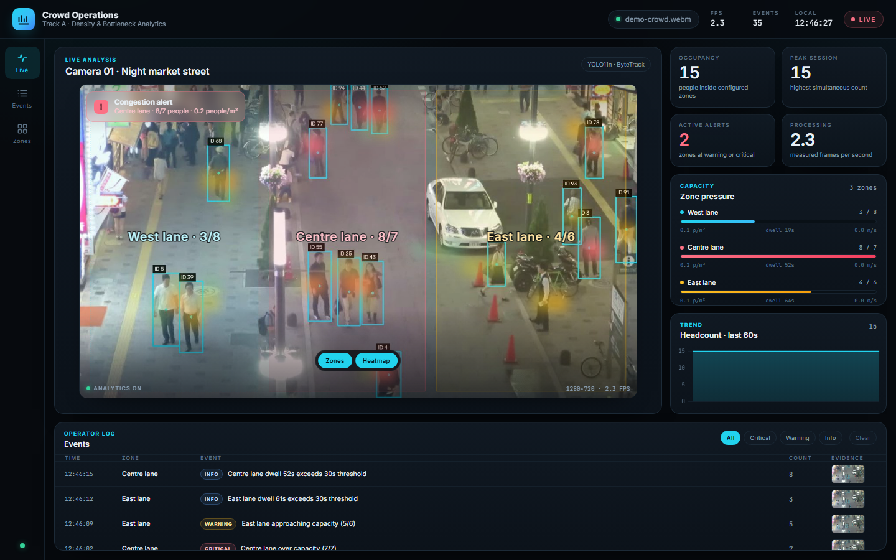
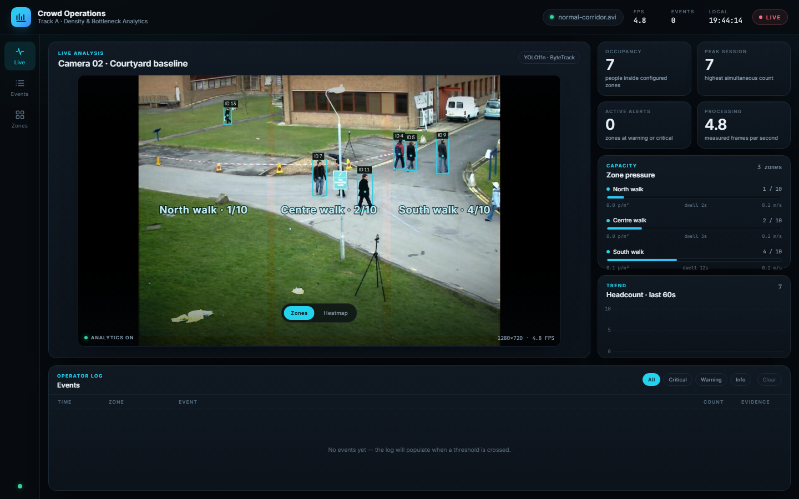

# Crowd Operations — CognoValley Track A

Crowd-density and bottleneck analytics for a fixed camera. A background Python
worker runs person detection and tracking on a video file, measures occupancy,
density, dwell time and speed inside configurable zones, and raises debounced
operator events. A dark-mode dashboard shows the annotated stream, live zone
pressure, a heat map, a 60-second trend chart and an evidence-backed event log.

Built for **Track A (crowd density and bottleneck analytics)** of the CognoValley
internship scope. Everything runs locally on CPU: Flask, Ultralytics YOLO11n,
ByteTrack, OpenCV, SQLite and plain HTML/CSS/JavaScript.



## What it demonstrates

| Requirement | Where it lives |
| --- | --- |
| Person detection + tracking | `app/detector.py` (YOLO11n + ByteTrack) |
| Zone occupancy and dwell rules | `app/zones.py`, `app/rules.py` |
| Event logging with evidence | `app/storage.py`, `data/snapshots/` |
| Live annotated video | `app/camera_worker.py`, `GET /video` (MJPEG) |
| Operator UI | `static/index.html`, `static/styles.css`, `static/js/` |
| Normal activity / false-positive check | `configs/normal.json` + `data/clips/normal-corridor.avi` |
| Measured performance | shown live in the **Processing** KPI and FPS readout |

## Quick start (Windows, PowerShell)

```powershell
cd cognovalley-crowd-ops
python -m venv .venv
.venv\Scripts\Activate.ps1
pip install -r requirements.txt

# Crowd demo — three lanes, warnings and capacity events
python -m app.main --config configs\demo.json --port 5000 --reset
```

Open <http://127.0.0.1:5000>. The first run downloads `yolo11n.pt` (about 5 MB)
if it is not already in the project root. Give it **~15 s**: Flask answers after
about 8 s, and the first annotated frame arrives around 15 s.

Normal-activity baseline on a second port:

```powershell
python -m app.main --config configs\normal.json --port 5001 --reset
```

`--reset` deletes stored events and evidence images so a rehearsal or the live
demo starts from zero. Without it, the log survives restarts.

### Bring your own clip

`--source` overrides the configured video file, so the same pipeline runs on any
local recording. Pass an absolute path and the single-zone config:

```powershell
python -m app.main --config configs\any-clip.json --source "C:\Videos\my-clip.mp4"
```

`configs/any-clip.json` uses one zone covering the whole frame, because the demo
lanes are drawn for the night-street camera and would sit in the wrong place on a
different scene. Occupancy then means "people on screen", and events are written
to a separate `data/any-clip.db` so a custom run never mixes with the demo log.
For a fixed camera you control, edit `zones` in the JSON instead — see
[Configuration](#configuration).

Any format OpenCV can decode works (MP4/H.264, AVI, WebM). A webcam index such as
`--source 0` also works where OpenCV can open the device. The input is letterboxed
to 16:9, so the zone overlay stays aligned whatever the source aspect ratio.

### Offline replay (no browser, prints expected results)

```powershell
python scripts\tune_zones.py configs\demo.json
python scripts\tune_zones.py configs\normal.json
```

### Tests

```powershell
pytest -q
```

19 tests cover rule timing/cooldowns, zone geometry, the SQLite store and the
shipped JSON configs.

## Demo scenario and expected results

| Run | Clip | What should happen |
| --- | --- | --- |
| `configs/demo.json` | `demo-crowd.webm` — night pedestrian street, 960×540, 30 fps, 35 s | 14–16 people in zones on average (p50 14, p90 16, peak ~21). Over a full pass the lanes raise warning and capacity events, plus a dwell event after ~30 s of continuous presence. Event count is **not fixed**: 1–7 in a given 60 s window, 7–16 per full pass depending on CPU load, because the 30 s cooldown is wall-clock time and the crowd peaks at different points. After a Clear the first event arrived in **7.9 s**. Heat map concentrates on the two walking lanes. |
| `configs/normal.json` | `normal-corridor.avi` — quiet corridor, 768×576, 10 fps, 79.5 s | 0 events, occupancy p50 5 / p90 6 / max 8, every lane stays `ok`. Demonstrates that thresholds do not fire on normal activity. |



Notes that keep the demo honest:

- The worker loops the clip, so the event total keeps growing if you leave it
  running. Use **Clear** (event log) or restart with `--reset` before a clean run.
- The demo config is tuned so the crowd clip crosses thresholds during the
  presentation window. It is a demonstration, not a calibrated venue model.
- Exact event timing varies with CPU load and where the loop starts.

Measured on the development laptop (Intel Core i5-1035G1, 4 cores / 8 threads,
CPU-only, 1280×720 processing). Each row is the condition stated in it; the
spread comes from whatever else is running.

| Condition | Measured |
| --- | --- |
| Worker + dashboard open in Chrome | **5–7 FPS** (5.1–6.9) |
| Worker with no browser attached | **~9.5 FPS** (8.9–10.0) |
| Two servers at once (demo + baseline) | **~4–4.5 FPS each** |
| Offline replay, no JPEG encoding or Flask | **5–9 FPS** (8.6 on a quiet machine) |

The target is 10 processed frames per second; the UI shows the measured value,
not the target. The pipeline skips two of every three source frames, so at 6 FPS
the 35 s demo clip takes about **60 s** to play through — roughly 1.7× slower than
real time. With nothing attached it reaches the 10 FPS target and a pass takes
about **37 s**. The 79.5 s baseline clip takes about 2.5 minutes alone, or
**3–3.5 minutes** while the demo worker is also running. Anything else using the
CPU shows up directly in this number.

## How it works

```
clip → decode/letterbox → YOLO11n person boxes → ByteTrack IDs
     → zone geometry (count, density, dwell, speed)
     → rule engine (debounce + cooldown) → SQLite + JPEG evidence
     → latest frame + stats snapshot → Flask → MJPEG + JSON → dashboard
```

See [`docs/architecture.md`](docs/architecture.md) and the diagram
[`docs/assets/architecture.svg`](docs/assets/architecture.svg).

Key design choices:

- **One worker thread owns inference.** Flask request handlers only read the
  latest published JPEG and a deep-copied stats snapshot, so polling never blocks
  on YOLO.
- **16:9 letterboxing in the worker.** The browser overlays zone polygons in a
  normalized 0–1 coordinate system, so the SVG overlay lines up with the frame
  regardless of the source aspect ratio.
- **Zones are configuration, not code.** Polygons, capacities, thresholds and
  FPS live in `configs/*.json`; the same engine runs both demo and baseline.
- **Rules need duration and cooldown.** A spike must last `alert_seconds` before
  it fires, and the same zone/event pair cannot repeat inside
  `cooldown_seconds`. This prevents per-frame alert spam.
- **Evidence, not just a count.** Every event writes an annotated JPEG and a
  SQLite row, so an operator can inspect what the model saw.

## Configuration

`configs/demo.json` and `configs/normal.json` override the defaults in
`app/config.py`. Unknown keys are ignored; missing keys fall back to defaults.

| Key | Meaning |
| --- | --- |
| `source` | Video file path (a webcam index such as `0` also works with OpenCV). Override at launch with `--source <path>` |
| `camera.name` | Title shown in the dashboard header |
| `zones[]` | `name`, normalized `polygon` points (0–1), `capacity` |
| `detector.conf` / `min_box_height` | Detection confidence and minimum person-box height in pixels |
| `rules.warning_ratio` | Fraction of capacity that counts as a warning |
| `rules.alert_seconds` | How long a condition must hold before an event is written |
| `rules.dwell_seconds` | Dwell threshold for an info event |
| `rules.cooldown_seconds` | Minimum gap between repeated events of the same type |
| `video.target_fps` | Processing/playback target; source frames are skipped to match |
| `video.pixels_per_meter` | Scale used for density and speed (see limitations) |

## API

| Endpoint | Purpose |
| --- | --- |
| `GET /` | Dashboard |
| `GET /video` | MJPEG stream of annotated frames |
| `GET /api/stats` | Occupancy, per-zone metrics, frame size, FPS, heat grid, event count |
| `GET /api/events?limit=60` | Recent events, newest first (max 200) |
| `POST /api/events/clear` | Delete events, evidence images and reset the session counter |
| `GET /api/health` | Lightweight status/FPS/source check |
| `GET /api/config` | Active zones, rules and video settings |
| `GET /snapshots/<file>` | Event evidence JPEG |

## Project layout

| Path | Responsibility |
| --- | --- |
| `app/main.py` | Flask factory, routes, CLI, snapshot cleanup |
| `app/camera_worker.py` | Worker loop, letterboxing, annotation, heat grid, stats publishing |
| `app/detector.py` | Thin YOLO/ByteTrack wrapper that returns `Track` objects |
| `app/zones.py` | Zone polygons, point-in-polygon, occupancy/density/dwell/speed |
| `app/rules.py` | Debounced warning, capacity and dwell events with cooldown |
| `app/storage.py` | SQLite event table and snapshot filename |
| `app/config.py` | Defaults, JSON merge, path resolution |
| `static/` | Dashboard: HTML, CSS, vanilla JS, vendored Chart.js |
| `scripts/tune_zones.py` | Offline clip replay: per-zone percentiles and fired events |
| `tests/` | Pytest unit tests |
| `configs/` | Demo, baseline and single-zone ("any clip") configurations |
| `docs/` | Architecture, decisions, demo script, screenshots |

## Licences and credits

| Component | Licence |
| --- | --- |
| This project's source code | MIT (see [`LICENSE`](LICENSE)) |
| [Flask](https://flask.palletsprojects.com/) | BSD-3-Clause |
| [Ultralytics YOLO11n](https://github.com/ultralytics/ultralytics) | **AGPL-3.0** |
| [ByteTrack](https://github.com/ifzhang/ByteTrack) | MIT |
| [OpenCV](https://opencv.org/) | Apache-2.0 |
| [NumPy](https://numpy.org/) | BSD-3-Clause |
| [Chart.js](https://www.chartjs.org/) (vendored) | MIT |
| Inter / JetBrains Mono | SIL Open Font License 1.1 (loaded from Google Fonts at runtime; system fallbacks) |
| MOT17-04 clip | **CC BY-NC-SA 3.0, non-commercial only** |
| OpenCV `vtest.avi` sample | Included with the Apache-2.0 OpenCV repository; provenance not separately documented |

**AGPL note for the panel:** Ultralytics YOLO is AGPL-3.0. This repository is
public and includes the full source, which satisfies the sharing obligation for
a coursework demo. AGPL is not suitable for a closed commercial product; the
permissive fallback is YOLOX (Apache-2.0) behind the same `PersonDetector`
interface. The MOT17 clip is non-commercial, so it must not be used in a paid
deployment.

Full clip attribution: [`data/clips/CREDITS.md`](data/clips/CREDITS.md).

## Honest limitations

- **No tracking accuracy metric.** The project does not report MOTA/IDF1
  because the bundled clips have no small hand-labelled evaluation split;
  detection quality is assessed visually. Do not claim benchmark accuracy.
- **CPU throughput.** 5–7 FPS with the dashboard open on the development laptop.
  The pipeline skips source frames to keep playback near real time; a 35 s clip
  still takes about a minute, so it is not a 30 FPS live system.
- **Perspective bias.** `pixels_per_meter` is a single fixed scale. People far
  from the camera appear smaller, so density and speed are biased by depth.
  A production system would calibrate a homography per camera.
- **Box-centre geometry.** A person counts inside a zone when the centre of their
  box is inside the polygon. Partial occlusion at a boundary can make a count
  flicker.
- **Occlusion and ID switches.** Heavy occlusion reduces recall and can reset a
  dwell timer when a track is lost.
- **Single camera, single worker.** No multi-camera aggregation, authentication
  or production WSGI server. MJPEG from the Flask dev server is fine for a local
  demo, not for deployment.
- **Snapshots accumulate.** Evidence JPEGs are only removed by **Clear** or
  `--reset`; there is no retention policy.

## Docs

- [`docs/architecture.md`](docs/architecture.md) — data flow, thread model, state.
- [`docs/decisions.md`](docs/decisions.md) — why this stack and these trade-offs.
- [`docs/demo.md`](docs/demo.md) — 12-minute walkthrough and expected results.
- [`docs/assets/architecture.svg`](docs/assets/architecture.svg) — architecture diagram.
