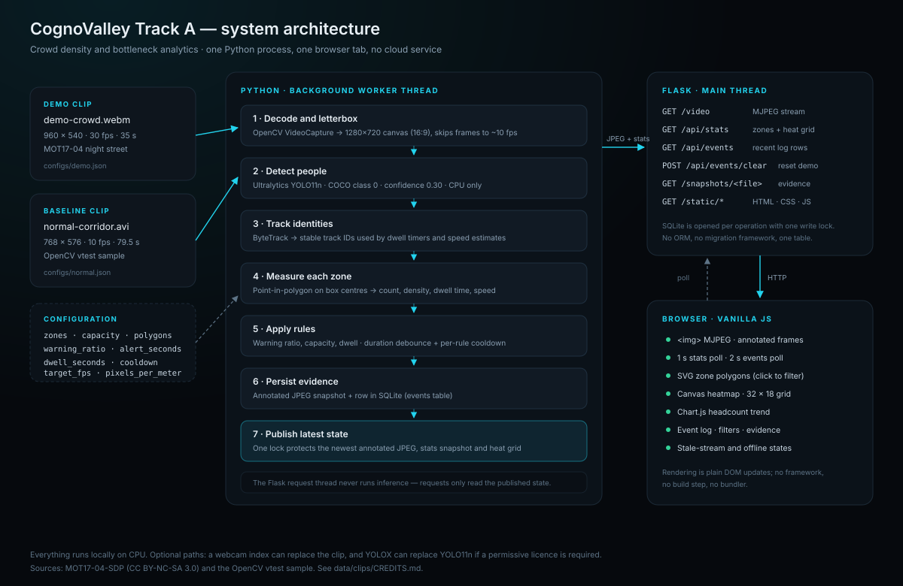

# Architecture



## One process, two threads

The application is a single Python process with two kinds of work:

1. **One background worker thread** (`CameraWorker`) owns the video source and
   the model. It decodes, detects, tracks, measures, applies rules, writes
   events and publishes the newest JPEG plus a stats snapshot.
2. **Flask request threads** only read that published state. `/video` streams the
   newest JPEG; `/api/stats` returns a deep copy; `/api/events` reads SQLite.
   No request handler runs inference.

This split is the main architectural decision. It keeps polling cheap and stops
a slow YOLO frame from blocking the UI.

```
                 ┌──────────────────────── worker thread ────────────────────────┐
video file ─────▶│ OpenCV → letterbox → YOLO11n → ByteTrack → ZoneEngine → Rules │
                 │                                      │                        │
                 │                                      ├─▶ EventStore (SQLite) │
                 │                                      ├─▶ JPEG snapshots      │
                 │                                      └─▶ latest JPEG + stats │
                 └───────────────────────────────┬──────────────────────────────┘
                                                 │ lock-protected read
                                      ┌──────────▼──────────┐
                                      │ Flask request threads│
                                      └──────────┬──────────┘
                                                 │ MJPEG + JSON
                                      ┌──────────▼──────────┐
                                      │ Browser (vanilla JS) │
                                      └─────────────────────┘
```

## Module map

| Module | Responsibility | Does not do |
| --- | --- | --- |
| `app/config.py` | Defaults, JSON deep-merge, project-root path resolution | No validation framework |
| `app/detector.py` | YOLO11n + ByteTrack, filters to COCO class 0 and minimum box height, returns `Track` objects | No zone logic |
| `app/zones.py` | Normalized polygons → pixel polygons; occupancy, density, dwell, speed; `reset()` | No event rules |
| `app/rules.py` | Warning / capacity / dwell rules with duration debounce and cooldown | No persistence |
| `app/storage.py` | SQLite table, parameterized insert/select, count, clear | No ORM, no migrations |
| `app/camera_worker.py` | Frame loop, letterbox, annotation, heat grid, snapshots, published state | No HTTP |
| `app/main.py` | Flask factory, routes, CLI flags, snapshot purge | No inference |
| `static/js/app.js` | 1 s polling, DOM rendering, SVG overlay, canvas heat map, filters, selection | No business logic |
| `static/js/charts.js` | Chart.js wrapper with a canvas fallback | No data fetching |

## One frame, step by step

1. **Read.** `cv2.VideoCapture` reads one frame. To keep playback near real time,
   the worker grabs and discards `round(source_fps / target_fps) - 1` frames
   first. For the 30 fps demo clip at `target_fps = 10`, two frames are skipped.
2. **Letterbox.** `_resize()` scales with `min(target_w / w, target_h / h)` and
   pastes the result into a black 1280×720 canvas. The output is always 16:9,
   which is what the browser overlay assumes.
3. **Detect + track.** `PersonDetector.detect()` calls
   `model.track(classes=[0], tracker="bytetrack.yaml", persist=True)`. Boxes
   shorter than `min_box_height` are dropped. Each result becomes a `Track` with
   `(id, x1, y1, x2, y2, confidence)`.
4. **Measure.** `ZoneEngine.update()` converts normalized polygons to pixels for
   the current frame, then computes the metrics below.
5. **Apply rules.** `RuleEngine.evaluate()` returns zero or more `Event` objects
   for this frame.
6. **Persist.** For each event the worker writes an annotated JPEG to
   `data/snapshots/` and inserts a row into SQLite. `events_total` increments.
7. **Publish.** The worker JPEG-encodes the annotated frame, builds a stats dict
   and swaps both into `_jpeg` / `_stats` under `self._lock`. `_frame_id`
   increments so the MJPEG generator can avoid resending duplicates.
8. **Pace.** `sleep(max(0, 1/target_fps - elapsed))`. If the machine is slower
   than the target, the sleep is zero and the measured FPS drops honestly.

## Metric definitions

Let a zone polygon have `n` pixel-space vertices and area
`A_px = |cv2.contourArea(polygon)|`.

| Metric | Definition |
| --- | --- |
| **Occupancy** | Number of tracks whose box **centre** is inside the polygon (`cv2.pointPolygonTest >= 0`). |
| **Density** | `occupancy / (A_px / pixels_per_meter²)`, in people/m². |
| **Dwell** | For each `(track_id, zone)` pair, `now - first_seen_at`. The timer is deleted when the track leaves the zone, so re-entry restarts it. `max_dwell` is the largest dwell among the tracks currently inside. |
| **Speed** | For each track inside, `hypot(dx, dy) / dt / pixels_per_meter`, averaged. The previous centre is kept per track and dropped after 3 s without a sighting. |
| **Heat grid** | A 32×18 accumulator. Every frame decays all cells with a 4-second time constant (half the weight every ~2.8 s), then adds 1 at each track centre. Cells are normalized by the current peak, so the published grid is always 0–1 and the glow follows the people currently on screen. |

Density and speed assume one fixed `pixels_per_meter`. This is a deliberate
simplification: it is explainable and testable, but not perspective-correct. See
`docs/decisions.md`.

## Rule semantics

For a zone with capacity `C` and `warning_ratio r`:

```
warning_at = r * C

if count >= C:
    start or continue an "over capacity" timer
    fire "capacity" (critical) once the timer >= alert_seconds
else:
    clear the timer

elif count >= warning_at:
    start or continue a "warning" timer
    fire "warning" once the timer >= alert_seconds
else:
    clear the timer

if max_dwell >= dwell_seconds:
    fire "dwell" (info)
```

Every fire also passes a cooldown check keyed by `(zone, event_type)`.
`_last_fired` is updated when the event is actually emitted, so a condition that
stays true produces at most one event per `cooldown_seconds`.

Events carry: `ts`, `zone`, `type`, `severity`, `message`, `count`.

## Published state

`CameraWorker.get_stats()` returns a deep copy of:

```json
{
  "ts": 1794059250.1,
  "source": "demo-crowd.webm",
  "camera": "Camera 01 · Night market street",
  "status": "live",
  "fps": 8.8,
  "frame": {"w": 1280, "h": 720},
  "occupancy": 14,
  "zones": [
    {
      "name": "West lane",
      "count": 5,
      "capacity": 8,
      "density": 0.1,
      "max_dwell": 9.4,
      "velocity": 0.4,
      "status": "ok",
      "polygon": [[0.02, 0.02], [0.32, 0.02], [0.32, 0.98], [0.02, 0.98]]
    }
  ],
  "heatmap": {"cols": 32, "rows": 18, "values": [0.0, 0.31, 0.87, "..."]},
  "events_total": 3
}
```

`GET /api/stats` adds `Cache-Control: no-store` so browsers never display a
stale snapshot. `/api/events` returns newest-first rows with the snapshot
filename. `/api/events/clear` deletes rows, deletes `*.jpg` evidence and resets
the session counter.

## Concurrency and reset behaviour

- `CameraWorker._lock` protects `_jpeg`, `_frame_id` and `_stats`.
- `EventStore._lock` serializes SQLite writes; each operation opens and closes
  its own connection (`check_same_thread=False`).
- When the clip ends, the worker seeks to frame 0, calls `detector.reset()`
  (drops the Ultralytics predictor so ByteTrack IDs restart) and
  `zone_engine.reset()` (clears dwell and speed history).
- `RuleEngine` is **not** reset on loop. Cooldown timestamps persist across
  passes, so the event stream is spread out rather than repeating instantly.
  A `--reset` restart is the clean way to start the demo from zero.
- If the source cannot be opened, status becomes `offline`; if the dashboard
  misses stats for 4 s it adds `.stale` and shows the OFFLINE badge.

## Coordinate systems

There are three coordinate spaces, and each conversion exists for a reason:

1. **Source pixels** — OpenCV and the detector work here.
2. **Normalized 0–1** — zone polygons are stored this way, so a config works at
   any output resolution. The engine multiplies by the letterboxed frame size.
3. **SVG viewBox 0 0 160 90** — the browser multiplies normalized points by
   160/90. This is an arbitrary unit grid with a 16:9 ratio; it does not need to
   match pixels because the SVG stretches with the video.

The worker always outputs 16:9. That is why the SVG overlay and the heat canvas
sit exactly over the JPEG even when the source is 768×576 (4:3): the 4:3 image is
pillarboxed inside the 16:9 canvas before anyone draws on it.

## Performance profile

On the development laptop (i5-1035G1, 4 cores / 8 threads):

| Stage | Approximate cost |
| --- | --- |
| YOLO11n inference at 1280×720 | dominant, roughly 60–90 ms/frame |
| Letterbox + annotation + JPEG encode | a few milliseconds |
| Zone geometry + rules | sub-millisecond |
| Browser polling + chart | negligible (JSON only) |

That yields 4–7 FPS with the dashboard open, 5–9.5 FPS with no browser attached,
4–4.5 FPS per worker when two run at once, and 5–9 FPS offline, depending on what
else is using the CPU. The target of 10 FPS is a pacing target, not a guarantee,
so a pass through the 35 s clip takes about a minute with the dashboard open.

## Failure modes and behaviour

| Failure | Behaviour |
| --- | --- |
| Missing/unreadable clip | `status = "offline"`, dashboard shows the offline banner |
| Clip ends | Seeks to 0, resets tracker/zone state, keeps running |
| Model weights missing | Ultralytics downloads `yolo11n.pt` on first run |
| Browser misses `/api/stats` for 4 s | `.stale` class: amber LIVE badge, offline dot |
| MJPEG `` error | Client retries `/video?t=…` after 2.5 s |
| SQLite locked or disk full | Worker logs and continues; current frame still publishes |
| Clear pressed | DB rows + snapshot JPGs deleted, session counter reset |

## Extension points

- Swap `PersonDetector` internals for YOLOX or a different tracker without
  touching `zones.py` or `rules.py`.
- Add a new rule by returning another `Event` from `RuleEngine.evaluate()`.
- Add a camera by running another worker and namespacing the stats payload; the
  current code is intentionally single-camera.
- Replace the JSON config with a zone editor: the engine already consumes
  normalized polygons.
